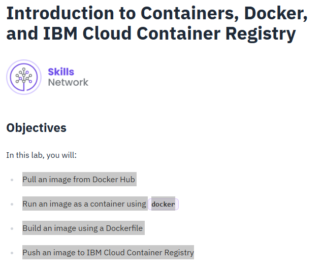

# Introduction to Containers and Docker Lab

## Overview
This laboratory covers foundational containerization workflows using Docker within the IBM Skills Network Cloud IDE environment[cite: 35, 37]. It documents repository initialization, container image execution from Docker Hub, daemon-client communication verification, and container lifecycle inspection[cite: 35, 36, 37].

---

## Lab Objectives
As outlined in the lab guidelines[cite: 37]:
* Pull an image from Docker Hub[cite: 37]
* Run an image as a container using `docker`[cite: 37]
* Build an image using a `Dockerfile`[cite: 37]
* Push an image to IBM Cloud Container Registry[cite: 37]



---

## Environment & Lab Setup

### 1. Repository Cloning & Working Directory
The lab workspace was initialized by cloning the course repository `CC201` from the IBM Developer Skills Network and navigating into the containerization lab subfolder.

```bash
# Clone the lab repository
git clone [https://github.com/ibm-developer-skills-network/CC201.git](https://github.com/ibm-developer-skills-network/CC201.git)

# Navigate into the Docker lab directory
cd CC201/labs/1_ContainersAndDocker/

# Inspect directory contents
ls
