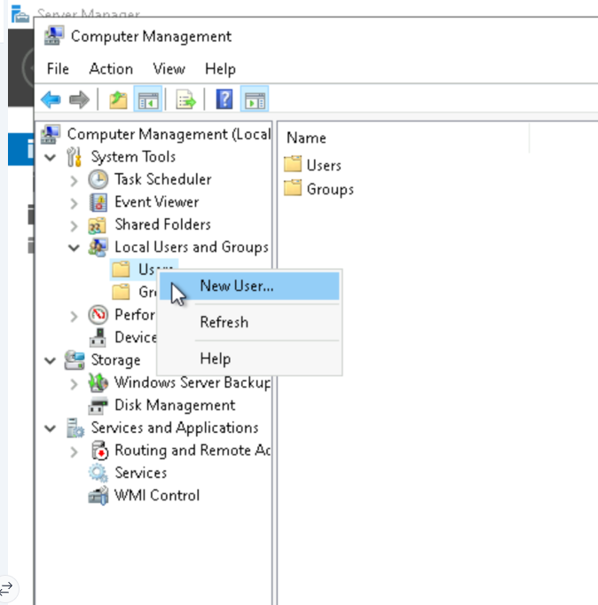
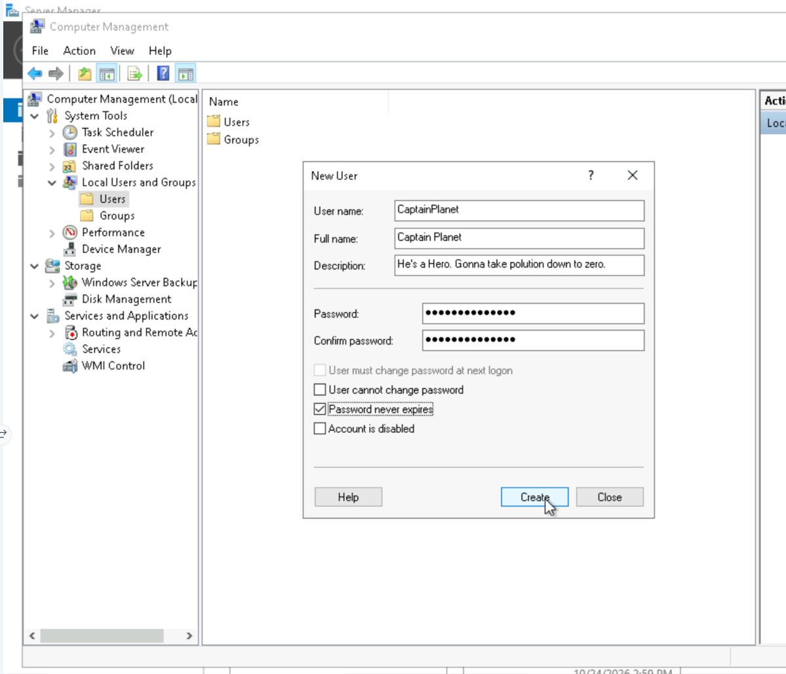
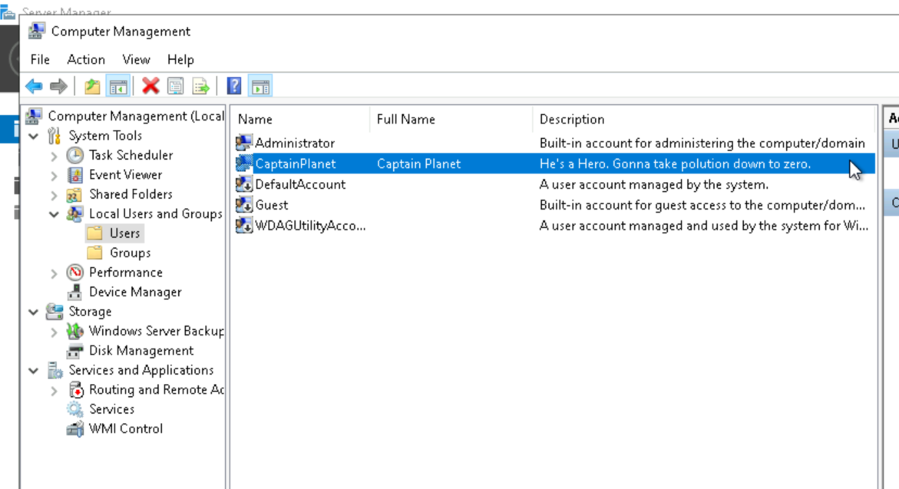

# Windows Local User Provisioning and Group Security Administration Lab

## Overview
This laboratory module documents end-to-end local identity management and access control configuration in Windows Server using the Microsoft Management Console (MMC) **Computer Management** utility (`compmgmt.msc`)[cite: 45, 52]. The exercises cover account provisioning within the local Security Accounts Manager (SAM), password lifecycle settings, custom departmental security group creation, and role-based group membership assignment[cite: 46, 47, 50, 53].

---

## Environment & Administrative Parameters
* **Platform:** Windows Server (Host / Domain: `EC2AMAZ-QQ8QTRT`)[cite: 47, 48]
* **Management Console:** Computer Management (`compmgmt.msc`)[cite: 45]
* **Snap-In Target:** System Tools > Local Users and Groups (`lusrmgr.msc`)[cite: 45]
* **User Account Created:** `CaptainPlanet`[cite: 52, 53]
* **Security Group Created:** `Accounting`[cite: 46, 49, 50]

---

## Step-by-Step Implementation & Verification

### Phase 1: Local User Account Provisioning

#### 1. Initiate User Creation
Under **Local Users and Groups**, right-clicked the **Users** container and selected **New User...** to launch the account wizard[cite: 45].

---

#### 2. Configure Account Credentials and Security Flags
Populated user identity metadata and configured credential persistence settings[cite: 53]:
* **User name:** `CaptainPlanet`[cite: 53]
* **Full name:** `Captain Planet`[cite: 53]
* **Description:** `He's a Hero. Gonna take polution down to zero.`[cite: 53]
* **Password Settings:** Defined secure password; selected **Password never expires** to bypass default password aging policies for this service account[cite: 53].

---

#### 3. Verify Account Creation in Local SAM
Committed account creation via **Create** and verified that `CaptainPlanet` appeared alongside built-in Windows accounts (`Administrator`, `DefaultAccount`, `Guest`, `WDAGUtilityAccount`)[cite: 52, 53].

---

### Phase 2: Security Group Configuration

#### 1. Initiate Security Group Creation
Right-clicked the **Groups** container within the console tree and selected **New Group...**[cite: 51].

---

#### 2. Define Departmental Group Metadata
Defined access boundary attributes in the **New Group** dialog and committed creation[cite: 50]:
* **Group name:** `Accounting`[cite: 50]
* **Description:** `Accounting group at work.`[cite: 50]

---

#### 3. Confirm Group Registration
Verified the newly instantiated `Accounting` group within the local groups repository alongside system defaults (`Administrators`, `Backup Operators`, `Remote Desktop Users`)[cite: 49].

---

### Phase 3: Group Membership Assignment (RBAC)

#### 1. Search and Locate Account Object
Opened **Accounting Properties**, selected **Add...**, and used **Advanced...** > **Find Now** to search the local machine directory (`EC2AMAZ-QQ8QTRT`)[cite: 46, 48]. Selected the target account `CaptainPlanet` from the search results[cite: 48].

---

#### 2. Resolve Security Object Name
Confirmed object name resolution to the fully qualified local security path `EC2AMAZ-QQ8QTRT\CaptainPlanet` and committed the selection via **OK**[cite: 47].

---

#### 3. Validate Group Membership
Verified that `CaptainPlanet` was successfully added under the **Members** list in **Accounting Properties**[cite: 46].

> **Security Note:** Group membership modifications update the user's security identifier (SID) mapping in the SAM database, but the change will only reflect in the user's active session after logging off and initiating a new logon session to rebuild the security access token[cite: 46].

---

## Key Administration & Security Concepts Practiced
* **Local Identity Management (SAM):** Creating and maintaining local security principals on standalone or cloud-hosted instances outside of Active Directory Domain Services (AD DS)[cite: 47, 52].
* **Password Policy Enforcement:** Controlling credential expiration parameters (`Password never expires` vs. `User must change password at next logon`)[cite: 53].
* **Role-Based Access Control (RBAC):** Aggregating permissions through functional groups (`Accounting`) rather than assigning individual discretionary access rights to individual user accounts[cite: 46, 50].
* **Access Token Mechanics:** Managing how Windows evaluates group SIDs during authentication and token issuance[cite: 46].
